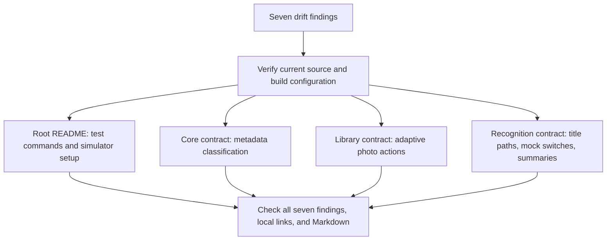

# Correct the Seven Documentation Drift Findings

- **Author:** Project owner with Codex
- **Status:** Proposed — all sections approved; finalized at docs/designs/correct-documentation-drift.md
- **Date:** 2026-11-02

## Overview

Update four repository READMEs so developers and coding agents can use them to run the appropriate tests, configure simulated scanning, and understand the existing recipe recognition and photo interface behavior. The work addresses the seven findings in the [2026-11-02 drift report](./2026-11-02_DRIFT_REPORT.md).

The source code defines the behavior these contracts describe. This design concerns documentation corrections; it does not propose changes to application behavior.

## The Problem

The documentation bootstrap left two descriptions broader than the implementation supports: the root README calls the app scheme's tests the full test suite, and the recognition contract states a title-length rule without limiting it to the analyzer candidates that actually use it.

Five further findings concern missing explanations: explicit simulator launch flags, parser metadata classification, adaptive photo action layout, the separate mock-preview and mock-capture switches, and the contents of generated analysis summaries. These gaps can lead readers to run incomplete verification, launch an unusable simulated scanner, or change behavior without understanding the existing conditions.

The simulator setup and mock-switch findings overlap but serve different readers. The root README needs usable launch instructions; the recognition contract needs the separate responsibilities of each switch. Both must describe the same behavior.

The main risk is replacing a short omission with an inaccurate universal rule. For example, the parser can supply a title that would fail the analyzer's candidate filter. Corrections must name the applicable path and conditions rather than claim that every title follows one rule. Documentation should describe the observable decision and cite its implementation, without copying entire private functions or treating every helper as a public interface.

## Goals

1. **Distinguish test coverage.** The root README identifies the Xcode scheme command as the app test suite and explains that the core Swift package tests require their own command.
2. **Make simulated scanning reproducible.** Root launch instructions explain how to enable both mock switches. The recognition contract states which switch bypasses camera permission and replaces the preview, and which supplies generated captures and bypasses OCR. It explicitly states that neither switch enables the other.
3. **Explain parser metadata classification.** The core source contract defines numeric badges and configured metadata-term matching, and explains where that classification affects title and subtitle selection. It preserves the distinction between preferred-title selection and fallback selection.
4. **Describe adaptive photo actions.** The library contract explains that preview/share buttons try a horizontal row first and fall back to a vertical arrangement, using the core layout constants.
5. **Scope title filtering accurately.** The recognition contract limits its six-character/two-word and blocked-term rules to analyzer candidate selection. It explains that a parser result takes precedence and is not subject to those same minimums.
6. **Explain persisted analysis summaries.** The recognition contract describes the optional subtitle, front-OCR cooking-time range and calorie matches, front/back line counts, and conditional back-OCR note used to build the stored summary.
7. **Close all seven findings with evidence.** Each finding maps to a correction in one of the four affected READMEs. Verification checks each statement against current source, resolves local links, and checks Markdown formatting. A later review can identify the disposition of every original finding.

## Non-Goals

- Change Swift code, application behavior, persistence, camera capture, recognition heuristics, UI layout, launch flag definitions, or test configuration.
- Add frameworks, dependencies, new product features, translations, or UI strings.
- Expand the seven unaffected README contracts or rewrite the repository's existing developer notes.
- Treat documentation review as evidence that builds, automated tests, or real-device camera checks have passed.

## Open Questions

None currently identified.

## Critical User Journeys

### CUJ 1: Run both test suites

- **Given:** A developer starts from the root README with the documented Xcode and Swift tools available.
- **When:** They follow Testing and System Verification.
- **Then:** They can identify separate commands for the app scheme and core Swift package, without assuming the app scheme runs the package test target.

### CUJ 2: Exercise a simulated scan

- **Given:** A developer runs the app in Simulator and follows the root README's mock instructions.
- **When:** They enable both scanner mock launch arguments and capture the front and back.
- **Then:** The instructions explain the replacement preview, generated photos, and fixed analysis result. They retain the explicit commit step in either save mode and explain that this path does not verify camera hardware or Vision OCR.

### CUJ 3: Understand recognition and photo layout boundaries

- **Given:** A maintainer reads the core, recognition, or library contract before changing its source.
- **When:** They follow the documented symbol references.
- **Then:** They can distinguish parser output from analyzer candidates, identify metadata classification and summary construction, and locate the photo action row's horizontal-to-vertical fallback.

## Technical Plan (Architecture)

### Documentation boundaries

Keep the existing application architecture. Update prose and source references in the four contracts identified by the drift report. The root README provides developer instructions; the leaf contracts describe the behavior and conditions of their own components. No public APIs, data models, storage formats, dependencies, or build targets change.

The seven findings are the review checklist. Use the current source to verify each correction, because the report is evidence of an earlier inspection rather than an executable specification. Keep the original report as that inspection record; record later verification separately when implementation is reviewed. This draft remains the design artifact and does not itself apply the README corrections.

This diagram describes documentation work, not an application runtime flow.

### Correction map

| Finding | Contract to update | Planned correction and source evidence |
| --- | --- | --- |
| 1. Full-suite wording | [Root README](./README.md) | Call the Xcode command the app test suite and show the core package command alongside it. Verify app testables in the [shared scheme](./RecipeRememberer.xcodeproj/xcshareddata/xcschemes/RecipeRememberer.xcscheme) and `RecipeRemembererCoreTests` in the [package manifest](./Packages/RecipeRemembererCore/Package.swift). Keep Testing and System Verification consistent. |
| 2. Simulator setup | [Root README](./README.md) | Add instructions to enable `-uiTestMockScanner` and `-uiTestMockScannerCapture` as launch arguments for a simulator run. Explain that Simulator alone does not enable mocks. Link to the recognition contract for switch responsibilities. Use [UITestLaunchConfiguration](./RecipeRememberer/App/UITestLaunchConfiguration.swift) and the scanner branches as evidence. |
| 3. Metadata classification | [Core contract](./Packages/RecipeRemembererCore/Sources/RecipeRemembererCore/README.md) | Describe one- or two-digit badges and configured normalized metadata-term matching. Cite `PreparedLine.extractBadgeValue(from:)`, `isMetadataLine`, and `metadataTerms` in [RecipeCardTextParser.swift](./Packages/RecipeRemembererCore/Sources/RecipeRemembererCore/RecipeCardTextParser.swift). Explain its effect on fallback anchoring, title expansion, and subtitle selection. |
| 4. Adaptive photo actions | [Library contract](./RecipeRememberer/Features/Library/README.md) | Explain `SavedRecipePhotoActionRow.body`: `ViewThatFits` tries the horizontal row first, with the minimum row width from `SavedRecipePhotoActionLayout`, and then the vertical stack. Cite [gallery source](./RecipeRememberer/Features/Library/SavedRecipePhotoGallerySection.swift) and [core constants](./Packages/RecipeRemembererCore/Sources/RecipeRemembererCore/SavedRecipePhotoActionLayout.swift). |
| 5. Title constraint scope | [Recognition contract](./RecipeRememberer/Features/Recognition/README.md) | Separate parser acceptance from prominent/fallback candidate filtering. `RecipePhotoAnalyzer.analyze` accepts the parser result first; `isLikelyFrontTitleLine` imposes the six-character/two-word and blocked-term rules on analyzer candidates. Cite [analyzer](./RecipeRememberer/Features/Recognition/RecipePhotoAnalyzer.swift) and the core parser. |
| 6. Independent mocks | [Recognition contract](./RecipeRememberer/Features/Recognition/README.md) | Document both flag names and their independent branches in [LiveTitleScannerView.swift](./RecipeRememberer/Features/Recognition/LiveTitleScannerView.swift): `cameraSurface` / `scannerState` use the preview flag, while `captureCurrentSide` / `analyzeCapturedPhotos` use the capture flag. Neither flag enables the other. |
| 7. Analysis summary | [Recognition contract](./RecipeRememberer/Features/Recognition/README.md) | Describe `RecipePhotoAnalyzer.analysisSummary`: detected title, optional subtitle, first matching front-OCR time range and calorie text, line counts, and conditional back-OCR note. Cite `firstMatch(in:for:)` and [AppModel.saveDraft](./RecipeRememberer/App/AppModel.swift) for storage of the result. |

### Conditions the prose must preserve

- **Metadata is not removed universally.** Preferred-title equality and containment checks run before fallback filtering in `anchorIndex`. Do not claim metadata lines can never anchor a title. Examples such as `min` and `protein` illustrate the configured list; matching uses `localizedStandardContains` on normalized text, rather than an exact-token rule.
- **Title filters belong to particular paths.** A parser result can be a one-word title such as `Soup`. The analyzer's final requirement is a nonempty trimmed title. An empty parsed subtitle is a value, so it does not trigger the nil-coalescing subtitle fallback.
- **Mocks are separate from normal capture.** The preview flag alone does not generate photo callbacks. The capture flag alone does not bypass authorization or replace the camera preview. Both flags are needed for the documented complete simulator path. The existing explicit scan commit remains necessary.
- **Summary extraction has limits.** Describe cooking time as a matched range, not arbitrary time recognition. The regexes select the first match in front OCR and are case-sensitive as written. The summary always labels the title as detected from the front photo even if the analyzer used its back-photo fallback; document this current wording without promising reliable provenance.
- **Layout fallback is based on fit.** The horizontal candidate has the core minimum row width; do not describe a universal screen-width breakpoint or claim that orientation alone selects the vertical stack.

### Verification approach

Check the seven rows against current source and the revised READMEs. Resolve every added relative link from its containing document, verify Markdown headings and code fences, and run `git diff --check`. Review the diff to confirm that implementation changes are limited to the four READMEs and preserve unrelated developer notes.

Validate the documented commands against the package manifest and shared scheme. No application behavior changes are proposed, so no new tests, production build, or camera session is required for this documentation correction. Report source inspection and formatting checks as such; do not claim an executed build or passing test suite.

## Alternatives Considered

No alternatives were evaluated. The project owner confirmed this during drafting; no rejected options or rejection reasons are recorded.

## Detailed Implementation Plan

### Unified implementation list

Apply the following documentation edits in order. These four existing READMEs are the complete implementation file list; no files are created or deleted by the correction work. This design draft is a planning artifact. Preserve the original [drift report](./2026-11-02_DRIFT_REPORT.md) as the dated inspection record and record finding dispositions in the completion review rather than rewriting that report.

#### 1. Modify [README.md](./README.md) — findings 1 and 2

**What and why:** Correct the test-suite label and make simulator mock setup usable without reading private implementation details.

- In Requirements, replace the ambiguous simulator note with an explicit statement that normal simulator runs do not automatically enable mocked scanning.
- In Running The App, add a simulator mock subsection after the normal run steps. Instruct the reader to edit the `RecipeRememberer` scheme's Run launch arguments, add and enable `-uiTestMockScanner` and `-uiTestMockScannerCapture` as two separate arguments, select a simulator, and run. These are arguments, not environment variables. Remove or disable both arguments to return to the normal camera path on a device.
- Explain the expected mock journey: open the scanner, capture the front and back using generated images, receive the fixed analysis result, and choose the explicit commit action. `Ask First` continues to pending review; `Auto Save` attempts saving after commit. Duplicate detection and save errors still apply. Do not promise that every commit creates a record.
- Explain that this mock journey exercises the capture/save interface without validating real camera capture or Vision OCR. Link to `./RecipeRememberer/Features/Recognition/README.md` for the independent responsibilities of the flags.
- In Testing, replace “Run the full test suite” with “Run the app unit and UI tests” for the existing Xcode command. Add the separate core command, `swift test --package-path Packages/RecipeRemembererCore`, and identify its `RecipeRemembererCoreTests` target. State that running both commands covers the two configured test suites. Keep the matching commands in System Verification consistent.
- Retain the existing simulator destination and its installed-runtime caveat, developer team guidance, normal device build command, privacy notes, and release links.

**Evidence to read:** [shared scheme](./RecipeRememberer.xcodeproj/xcshareddata/xcschemes/RecipeRememberer.xcscheme), [package manifest](./Packages/RecipeRemembererCore/Package.swift), [launch arguments](./RecipeRememberer/App/UITestLaunchConfiguration.swift), and [scanner flow](./RecipeRememberer/Features/Recognition/LiveTitleScannerView.swift).

**Acceptance:** Testing distinguishes both commands and target groups. The mock subsection names both enabled arguments and the commit/review behavior; it makes no claim that Simulator itself enables mocks or that mocked analysis verifies OCR.

#### 2. Modify [Packages/RecipeRemembererCore/Sources/RecipeRemembererCore/README.md](./Packages/RecipeRemembererCore/Sources/RecipeRemembererCore/README.md) — finding 3

**What and why:** Define “nonmetadata” so a maintainer can understand which OCR lines participate in parser decisions.

- In Invariants, add a bullet next to the existing parser bullets describing private `PreparedLine` classification. A trimmed transcript matching a one- or two-digit badge is metadata. Other lines are metadata when their normalized text matches a configured `metadataTerms` entry through `localizedStandardContains`.
- Give representative terms such as `min`, `kcal`, and `protein`, and identify the source list as authoritative rather than reproducing it as a second maintained list. Do not describe matching as exact whole-word matching or imply that metadata terms require a digit in the line.
- Explain the three affected decisions: fallback anchor candidates exclude metadata, title expansion does not join metadata lines, and subtitle selection skips metadata lines.
- Clarify that preferred-title equality/containment checks happen before fallback filtering and can select a metadata anchor. Do not claim all metadata lines are removed from parser input.
- Cite `PreparedLine.extractBadgeValue(from:)`, `PreparedLine.isMetadataLine`, `PreparedLine.metadataTerms`, and `RecipeCardTextParser.anchorIndex(in:preferredTitle:)` in `./RecipeCardTextParser.swift`. Keep the helper's private visibility clear.

**Evidence to read:** [RecipeCardTextParser.swift](./Packages/RecipeRemembererCore/Sources/RecipeRemembererCore/RecipeCardTextParser.swift), especially `PreparedLine`, `anchorIndex`, `shouldJoinTitleLine`, and `subtitleCandidate`.

**Acceptance:** The contract describes badge and term classification, its effects, and the preferred-title exception. Existing public API and side-effect sections retain their scope.

#### 3. Modify [RecipeRememberer/Features/Library/README.md](./RecipeRememberer/Features/Library/README.md) — finding 4

**What and why:** Record the implemented layout fallback so future changes preserve both photo actions when horizontal space is insufficient.

- Add an Invariants bullet adjacent to gallery/preview behavior. Name private `SavedRecipePhotoActionRow.body` and explain that `ViewThatFits(in: .horizontal)` tries the Preview/Share horizontal row first, then the vertical stack when the row does not fit.
- Identify `SavedRecipePhotoActionLayout.minimumHorizontalRowWidth` as the horizontal candidate's minimum width, and the shared spacing/minimum button height constants as the controls' layout inputs. Avoid presenting 236 points as a screen-wide breakpoint; the fit decision depends on the candidate's available space.
- Link the gallery using `./SavedRecipePhotoGallerySection.swift`. Identify the cross-subsystem constants using the repository path `/Packages/RecipeRemembererCore/Sources/RecipeRemembererCore/SavedRecipePhotoActionLayout.swift` in inline code, with the symbol name. Keep private UI helpers out of the public API description.

**Evidence to read:** [SavedRecipePhotoActionRow and its buttons](./RecipeRememberer/Features/Library/SavedRecipePhotoGallerySection.swift), [layout constants](./Packages/RecipeRemembererCore/Sources/RecipeRemembererCore/SavedRecipePhotoActionLayout.swift).

**Acceptance:** Both layout candidates, the fit condition, and the constant dependency are documented without inventing a device or orientation breakpoint.

#### 4. Modify [RecipeRememberer/Features/Recognition/README.md](./RecipeRememberer/Features/Recognition/README.md) — findings 5, 6, and 7

**What and why:** Separate the recognition paths, expose independent mock controls, and describe the summary stored with a recipe.

- Split the existing title/subtitle Invariants bullet into smaller bullets. Retain the existing title precedence. Limit the six-character/two-word requirement and blocked-term filtering to `isLikelyFrontTitleLine` used by prominent/fallback candidates. Explicitly state that a parsed title takes precedence and has no equivalent minimum; a one-word example such as `Soup` is possible when the parser accepts it. Keep the final nonempty trimmed-title guard and its error. Explain that an empty parsed subtitle does not trigger fallback because it is non-nil.
- Replace the vague “mock scanner configuration” wording in the authorization bullet with `shouldUseMockScanner` and its argument `-uiTestMockScanner`. Explain that it returns the ready scanner state and replaces the preview, without producing images or analysis on its own.
- Expand the mock Side Effects bullet to identify `shouldUseMockScannerCapture` and `-uiTestMockScannerCapture`. It supplies generated photos in `captureCurrentSide` and substitutes the fixed analysis in `analyzeCapturedPhotos`; it does not replace the preview or bypass camera authorization. State that neither flag enables the other. Link the root mock instructions with `../../../README.md#running-the-app` and retain local scanner/seeder symbol citations.
- Add an Invariants bullet for `RecipePhotoAnalyzer.analysisSummary`: it starts with the detected title, includes a nonempty subtitle, adds the first front-OCR time-range match and calorie match when present, always includes front/back line counts, and adds the back-OCR note only when back text is nonempty. Time ranges use one- or two-digit endpoints and the supported `Min`, `Minute`, or `Minutes` spelling; calorie matches use two to four digits followed by `kcal`. The patterns are case-sensitive as written. Do not imply arbitrary nutrition or duration extraction.
- Note that the summary currently calls the title front-photo-derived even when back-photo fallback supplied it. This is current output wording, not a provenance guarantee or a request to change source behavior.
- Cite `analysisSummary` and `firstMatch(in:for:)` through `./RecipePhotoAnalyzer.swift`. Identify `AppModel.saveDraft(_:using:)` at repository path `/RecipeRememberer/App/AppModel.swift` in inline code to establish that the generated string is copied to the record without recomputation.
- Retain the explicit scan commit requirement, pending review guards, camera/crop behavior, OCR language settings, and the distinction between module-internal types and private helpers.

**Evidence to read:** [analyzer](./RecipeRememberer/Features/Recognition/RecipePhotoAnalyzer.swift), [scanner](./RecipeRememberer/Features/Recognition/LiveTitleScannerView.swift), [launch switches](./RecipeRememberer/App/UITestLaunchConfiguration.swift), [save policy and summary persistence](./RecipeRememberer/App/AppModel.swift), and [parser](./Packages/RecipeRemembererCore/Sources/RecipeRemembererCore/RecipeCardTextParser.swift).

**Acceptance:** All three findings are addressed. The root setup and recognition flag descriptions agree, analyzer candidate restrictions are not applied to parser output, and summary construction is described with its actual conditions and limits.

### Verification Plan

1. Read the current contents of all four edited READMEs after the corrections. Compare each of the seven rows in the correction map with the source symbols cited above; assign each original finding a disposition in the completion review. All seven must be resolved before claiming completion.
2. Check these boundary cases by tracing source branches: preview flag only; capture flag only; both flags; a parser-accepted one-word title; a preferred-title metadata anchor versus fallback metadata exclusion; horizontal versus vertical photo actions; summary with and without optional matches or back OCR. This is source inspection, not an assertion that the app was executed.
3. Inspect the shared scheme's testables and the package manifest's test target. Confirm the README's two commands correspond to those configured suites and that Testing agrees with System Verification.
4. Resolve local Markdown links from each edited README, including fragment anchors. Check that source paths written as repository paths identify existing files and that cited symbols exist. Preserve `Interface`, `Invariants`, `Side Effects`, and verification sections, valid table separators, and balanced fenced blocks.
5. Run `git diff --check`; inspect the four edited files in full as well as their diff. Some contracts are currently untracked from bootstrap, so a tracked diff alone does not cover all edits. Do not stage or commit files as part of this correction.
6. Confirm this implementation added no changes outside the four target READMEs, accounting for pre-existing bootstrap artifacts, the report, this design artifact, and unrelated user work. Report the seven finding dispositions and checks performed in the completion response. Do not create another report file for that response.

No Swift files, unit tests, UI tests, project settings, or package manifests are edited. Compilation and test execution are not required for these prose-only corrections. The README retains runnable build/test instructions, but verification reports must distinguish validating their configuration from actually running them. SwiftLint does not validate these Markdown edits; no commit is part of this plan.

### Additional Resources

- [Drift report and source evidence](./2026-11-02_DRIFT_REPORT.md)
- [Root README](./README.md)
- [Core source contract](./Packages/RecipeRemembererCore/Sources/RecipeRemembererCore/README.md)
- [Library contract](./RecipeRememberer/Features/Library/README.md)
- [Recognition contract](./RecipeRememberer/Features/Recognition/README.md)

*Drafted with EGM*
